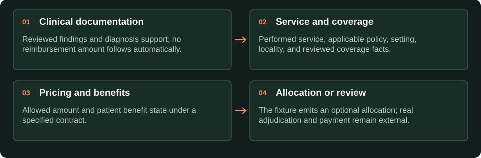
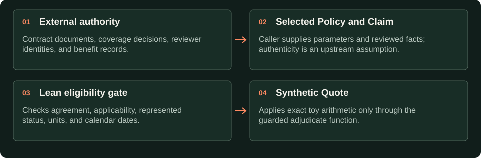
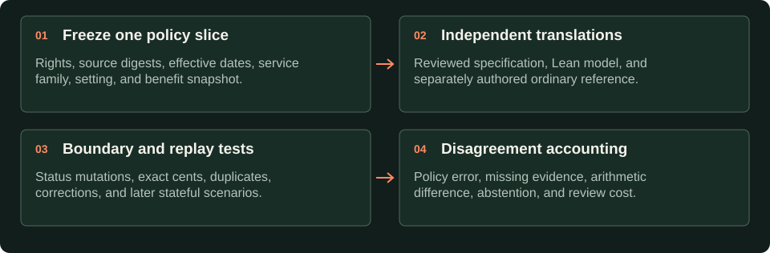

# Checked eligibility and conserved reimbursement arithmetic in Lean

A synthetic payer contract with thirteen proved properties, twenty-nine regression checks, and a source-grounded path toward real-policy evaluation

**Revanth Matha · Matha Labs | Whitepaper 2.0 | Revised 16 November 2026**

First published 15 November 2026 at 3:12:52 PM PST. Evaluated code: `13a03b01f60094f96c72959ea2d55c408f9e3ae8`.

## Abstract

Healthcare reimbursement requires more than assigning a diagnosis identifier. Service classification, contract selection, setting, locality, coverage, authorization, benefit state, and payment edits can all affect the applicable computation. This paper examines a small formal interface for that larger problem. A Lean 4 verifier checks a reviewed claim against a caller-supplied, versioned synthetic policy. The guarded function returns an optional allocation calculated with natural-number cents, a billed-amount cap, an applied deductible, and a capped fixed copay. Thirteen named theorems establish selected eligibility preconditions, rejection behavior, amount bounds, and conservation of the allowed amount for all represented numerical inputs. Twenty-nine authored regression cases pass when the pinned source is re-executed. None uses a real payer rate or patient record. We contrast the fixture with the Medicare Physician Fee Schedule methodology and distinguish coverage from coding and payment. We also identify a crucial trust limitation: agreement between claim and policy identifiers does not authenticate the caller-supplied contract, and the numerical helper can be invoked without the eligibility wrapper. The contribution is therefore a checked research kernel rather than a claims adjudication or payment guarantee. A prospective evaluation specifies independent policy translation, benefit-state snapshots, reference arithmetic, adversarial boundary cases, and separate error accounting for missing evidence, coverage decisions, and monetary differences. Real-policy validation, stateful deductible coordination, and transactional payment execution remain unimplemented.

Keywords: Lean 4, reimbursement, payer rules, integer arithmetic, formal verification, Medicare Physician Fee Schedule, coverage, policy provenance

## Contributions

1. A deterministic eligibility predicate binding reviewed claim fields to a selected synthetic policy, service, setting, locality, date, and unit bound.
2. Integer-cent allocation with universal conservation and individual amount bounds, checked by Lean rather than inferred from selected numerical examples.
3. Thirteen exact named theorems and twenty-nine replayable synthetic checks, with no claimed payer accuracy or realized payment results.
4. A primary-source comparison with actual Medicare methodology and a proposed evaluation and governance design that exposes unimplemented policy and benefit-state dependencies.

## 1. Separate the questions before calculating an amount

A request for reimbursement can conceal several distinct decisions: whether a condition is documented, what service was performed, whether a particular policy covers that service in context, which price rule applies, and how benefit state allocates the allowed amount. A system that jumps from a diagnosis identifier to a dollar figure has skipped those dependencies. CMS explicitly explains that a national coverage determination does not itself assign a code or determine the amount of payment. The separation is institutional as well as computational. [6]

This project asks a bounded question: can a deterministic, inspectable kernel refuse incomplete represented facts and preserve exact monetary invariants once a synthetic contract is selected? The answer is demonstrated through source code, proofs, and regression cases. The question is not whether a model can recover a payer's full adjudication logic from prose or predict remittances. Those tasks require additional data, independent labels, and explicit policy authority that this repository does not contain. [11,12]

The companion clinical-coding artifact is not imported by this implementation. diagnosisSupported is a Boolean field in Claim, supplied by an upstream reviewer or application. There is no proof that this flag came from a valid clinical certificate, no identifier tying it to a patient encounter, and no diagnosis-to-service coverage model. An integrated future system should preserve these distinctions instead of presenting the two repositories as a completed end-to-end clinical billing workflow.

### Figure 1. Distinct layers in a reimbursement decision



The figure organizes the domain. Only a small reviewed-input gate and synthetic allocation at the final two layers are implemented; the arrows do not represent delivered clinical or payer integrations. [1,6,11]


## 2. What actual Medicare pricing requires

CMS describes the Physician Fee Schedule as using work, practice-expense, and malpractice relative value units with geographic practice cost adjustments. A conversion factor turns the weighted relative value into a payment-rate component. Chapter 12 of the Medicare Claims Processing Manual provides the computation framework and additional adjustment topics, including site-of-service and other policy distinctions. These are background sources for requirements discovery; no relative-value file or conversion factor is loaded by the executed fixture. [1,2]

A schematic base formula is useful for showing why a single diagnosis lookup is insufficient. It is not a complete payment algorithm: code status, setting-specific parameters, modifiers, coverage, payment-policy indicators, and other applicable adjustments may matter. CMS's relative-value file publication and lookup documentation are therefore separate evidence sources from a coverage determination or a benefit accumulator. A real implementation would need the correct versions and applicability rules for each dependency rather than copying a single displayed amount. [1,2,4]

The 2026 final rule describes policies effective on or after January 1, 2026. A 2027 final-rule fact sheet was published November 4, 2026 for changes effective on or after January 1, 2027. Its publication before the synthetic November 15 service date does not make it the governing 2026 schedule. This paper reports no live conversion factor or rate estimate; the temporal example illustrates why publication time, effective time, and service time must remain distinct. [3,8]

```text
Schematic base rate = CF * (RVU_work*GPCI_work + RVU_PE*GPCI_PE + RVU_MP*GPCI_MP)
```

CF is a conversion factor; RVU components represent work, practice expense and malpractice; each GPCI is the corresponding geographic adjustment. This is contextual MPFS methodology, not the implemented toy formula or a complete payable-claim computation. [1,2]


## 3. The implemented contract and deliberate omissions

The executed Policy uses source urn:mathalabs:synthetic-payer, revision fixture-v1, payer SYNTH-PAYER, service SYNTH-CONSULT, and locality SYNTH-LA. Its interval is January 1, 2026 through the exclusive January 1, 2027 endpoint. The invented unit rate is 12,500 cents, maximum units four, and fixed copay 2,500 cents. These are synthetic parameters, not transcribed government amounts, procedure descriptors, actual locality identifiers, or terms offered by an insurer. [12]

All claims must use the office constructor and explicit positive coverage, authorization, network, and diagnosis-support facts. This is a conservative fixture interface, not a statement that every real service requires prior authorization or that a positive authorization guarantees payment. Real coverage questions belong to the relevant program and contract. CMS's NCCI publications and place-of-service code set identify further dimensions that the fixture represents only very coarsely or omits completely. [5,7]

The fixed-copay allocation also does not model Medicare beneficiary cost sharing. It has no coinsurance percentage, supplemental payer, benefit maximum, or rule for exceptions. A human reader should be able to identify the invented contract from every displayed example. Expanding this artifact into real-policy work would require source rights, reviewed interpretations, and an explicit test oracle, not relabeling the same constants as Medicare.

### Table 1. Real-policy dimensions versus the synthetic fixture

| Dimension | Implemented here | Unimplemented requirement |
| --- | --- | --- |
| Pricing | Invented cents-per-unit rate | Versioned payer or MPFS pricing and applicable adjustments. |
| Service identity | SYNTH-CONSULT string equality | Reviewed procedure-code and modifier semantics. |
| Place and locality | Office enum and SYNTH-LA string | Actual place-of-service mapping and locality applicability. |
| Coverage and authorization | Externally reviewed Option Bool fields | Policy-specific evidence and authenticated determinations. |
| Claim edits | Positive units at most four | Procedure-to-procedure, unit and other applicable edits. |
| Benefits | Supplied remaining deductible plus fixed copay | Patient-specific accumulators and contract-specific cost sharing. |
| Settlement | No action beyond returning data | Claim submission, remittance, appeals, and payment execution. |

The right column lists research requirements, not completed features. Official materials motivate these distinctions; none is claimed as fully formalized in the fixture. [1,2,5,6,7,11]


## 4. Data structures and the contract-selection trust boundary

Policy contains source ID, revision, payer, service, locality, interval endpoints, rate, unit cap, and copay. Claim contains matching identifiers plus place, service date, units, billed amount, remaining deductible, coverage, authorization, network status, and diagnosis support. Quote contains allowed, patient, and payer cents. Monetary fields and units are natural numbers. This prevents negative values inside the represented type but does not define a parser for external signed or fractional amounts. An integration must reject unsupported representations explicitly. [11]

Coverage and authorization are Option Bool values. none means missing information, some false a reviewed negative fact, and some true a reviewed positive fact. The eligibility predicate accepts only the positive case. This distinguishes unknown from false at the input level while the output none combines their refusal behavior. The application should retain that distinction for human review; a missing fact is not a final denial and does not establish zero entitlement.

A particularly important limitation is that Policy is caller supplied. The function checks claim-to-policy equality, not policy-to-authority authenticity. A caller can provide a different rate and matching identifiers, and the arithmetic will use that rate. The model has no compiled authoritative contract registry, signature verification, reviewer access control, or immutable benefit ledger. The source and revision fields organize a selected model; they do not prove that the selected model is a genuine payer contract.

### Figure 2. Assumed evidence and executed checks



Policy authentication and semantic review are outside the existing model. The figure makes that boundary explicit rather than suggesting that identifier equality authenticates a contract. [11]


## 5. Eligibility conditions and refusal semantics

Conditions contains eighteen conjuncts. It requires matching policy source, revision, payer, service, and locality; office setting; an ordered interval; service-date membership; positive units within the selected cap; positive coverage and authorization; in-network status; diagnosis support; and valid calendar dates for the claim and both endpoints. verify decides that proposition. adjudicate returns some Quote only when verification succeeds. Otherwise it returns none. [11]

The source includes a separate public helper calculate that always performs the numerical allocation on its arguments. It is not eligibility protected. This distinction matters in any wrapper or demonstration: calling calculate on a claim with missing coverage proves nothing about eligibility. The rejection theorem applies to adjudicate, the guarded function. An operational API should expose the intended boundary deliberately and label any standalone calculator as arithmetic only.

The calendar checks prevent impossible dates such as February 30 from passing a numeric range test. They do not decide which event date governs a payer rule or resolve a retroactive correction. Similarly, the unit cap of four is only a fixture rule, not an NCCI medically unlikely edit. The predicate's precision makes these assumptions visible, but it cannot supply the omitted domain interpretation. Real claim-edit rules require their own reviewed source and exception semantics. [5,11]


## 6. Exact cents, caps, and conservation

The calculation first caps the allowance at the smaller of billed cents and contract cents per unit multiplied by units. It then applies a deductible no larger than the allowance. From the residual it applies a fixed copay no larger than that residual. The payer receives the remaining residual, and the patient allocation is applied deductible plus applied copay. Every operation is over natural-number cents; no floating-point approximation or per-step decimal rounding occurs. This exactness depends on the input contract already expressing amounts as integer cents. [11]

The important invariant is conservation: patient cents plus payer cents equals allowed cents. It holds for every represented policy and claim, even when eligibility fails or parameters are economically unrealistic. Individual allocations cannot exceed the allowance, and the allowance cannot exceed billed cents or the unit-rate product. These facts rule out certain arithmetic inconsistencies without establishing that any rate or cost-sharing order is appropriate.

A large deductible or copay cannot create a negative residual because each application is capped before subtraction. Zero billed cents stays zero. The model contains no shared state, however, so it does not update or reserve deductible balances. Two simultaneous calls can each use the same supplied remaining deductible. Conservation inside each call does not establish consistency across calls, correct ledger updates, or a valid allocation across several payers.

```text
A=min(B,R*U); D=min(D_remaining,A); S=A-D; C=min(C_fixed,S); Patient=D+C; Payer=S-C
```

B, R, D_remaining and C_fixed are natural-number cents; U is units. A is the allowance and S the residual. This is the exact implemented synthetic contract order, not MPFS pricing or a general insurer cost-sharing formula. [11]


## 7. Exact theorem inventory

Thirteen named theorems are checked at the pinned commit. The eligibility theorems constrain represented reviewed facts; the arithmetic theorems quantify over every Policy and Claim value. Neither family establishes medical necessity, entitlement, or a payer's obligation. Separating them avoids using a universal arithmetic proof to justify an unsupported coverage decision. [11]

The proofs contain no project-specific axiom, admitted result, unsafe declaration, or proof placeholder. They use Lean 4.35.0 and its ordinary logical foundations. A reproducible review should examine both statements and executable definitions, because a theorem about an incomplete predicate can be correct while the application remains inadequate. [13]

### Table 2. Thirteen statements in Reimbursement/Model.lean

| Named theorem | Statement | Interpretation |
| --- | --- | --- |
| verification_iff | verify(p,c)=true iff Conditions(p,c) | Acceptance is exactly the represented gate. |
| accepted_requires_coverage | verify(p,c)=true implies c.coverage=some true | Requires a reviewed positive coverage input. |
| accepted_requires_authorization | verify(p,c)=true implies c.authorization=some true | Fixture authorization requirement; no authenticity proof. |
| accepted_requires_supported_diagnosis | verify(p,c)=true implies c.diagnosisSupported=true | Boolean support, not a clinical certificate integration. |
| accepted_date_in_window | verify(p,c)=true implies p.startDate<=c.serviceDate<p.endDateExclusive | Both selected-policy date bounds hold. |
| unknown_coverage_refused | c.coverage=none implies verify(p,c)=false | Missing coverage cannot produce acceptance. |
| unknown_authorization_refused | c.authorization=none implies verify(p,c)=false | Missing authorization cannot produce acceptance. |
| rejected_has_no_quote | verify(p,c)=false implies adjudicate(p,c)=none | The guarded wrapper returns no allocation. |
| allowed_le_billed | calculate(p,c).allowedCents<=c.billedCents | Allowance is capped by the billed amount. |
| allowed_le_contract | calculate(p,c).allowedCents<=p.centsPerUnit*c.units | Allowance is capped by the selected contract product. |
| conservation | calculate(p,c).patientCents+calculate(p,c).payerCents=calculate(p,c).allowedCents | Exact universal allocation conservation. |
| patient_le_allowed | calculate(p,c).patientCents<=calculate(p,c).allowedCents | Patient allocation is bounded. |
| payer_le_allowed | calculate(p,c).payerCents<=calculate(p,c).allowedCents | Payer allocation is bounded. |

p denotes Policy and c Claim. The source implements these statements for the toy calculation; none is a legal payment guarantee. [11]


## 8. Executed synthetic allocations and failures

The base claim has one invented unit billed at 20,000 cents, a synthetic rate of 12,500 cents, remaining deductible of 1,000 cents, and fixed copay of 2,500 cents. Its allowance is therefore 12,500 cents; the residual after deductible is 11,500; the patient allocation is 3,500; and the synthetic payer allocation is 9,000. The tuple is data returned under an invented contract, not a bill or actual patient responsibility. [12]

Changing billed cents to 5,000 caps the allowance at 5,000. An oversized remaining deductible assigns the entire 12,500-cent allowance to the patient within the toy rule, leaving zero payer allocation. An oversized copay does the same after the deductible. These examples establish caps in concrete cases; the universal theorems provide the stronger arithmetic guarantee. They do not imply that a real insurer applies those cost-sharing rules.

The negative cases preserve numerical plausibility while removing required evidence. Unknown coverage or authorization, mismatched payer or locality, wrong policy source, unsupported setting, missing diagnosis support, and invalid units all fail verification. Supplying I10 in the service-code field is refused because the invented service identifier no longer matches. The case illustrates that a diagnosis identifier is not an interchangeable procedure identifier, without claiming to validate a real code system.

### Table 3. Selected existing fixture outcomes

| Synthetic case | Executed result | Meaning |
| --- | --- | --- |
| Base reviewed claim | some Quote(12500,3500,9000) | Allowed, patient and payer cents under invented terms. |
| Coverage unknown | Verification false | No quote through adjudicate; not a final payer denial. |
| Authorization unknown | Verification false | The selected fixture requires a positive reviewed fact. |
| Billed cents reduced to 5000 | Allowance 5000 | The billed-amount cap applies. |
| Remaining deductible 99999 | Quote(12500,12500,0) from calculate | Standalone arithmetic edge case, not an eligibility decision. |
| Service date 20270101 | Verification false | The fixture excludes its end date. |
| Impossible service date 20260230 | Verification false | Calendar validity is checked before acceptance. |

Rows are selected from the twenty-nine authored checks. Helper-calculator cases are labeled separately from guarded eligibility results. All displayed amounts are synthetic cents. [12]


## 9. Present evaluation and unmeasured outcomes

The executable reports twenty-nine passing named checks. They cover positive and negative coverage and authorization, policy identity, service and locality, setting, network status, diagnosis support, unit boundaries, revision, effective dates, invalid intervals, invalid calendar dates, exact allocation, and extreme monetary inputs. A compile-time example evaluates the same list. Re-execution with the pinned toolchain and the source-hole check passes. These are reproducibility and regression results. [11,12]

There are no adjudicated real claims, actual payer decisions, denial-recovery results, reimbursement forecasts, latency measurements, or estimates of financial benefit. The examples are chosen by the authors and do not approximate a representative claims distribution. Twenty-nine passing assertions therefore cannot be reported as a claims accuracy percentage. The data type also has no calibrated confidence or probabilistic output to evaluate.

The suite is not a complete property-based or mutation-testing system. Universal conservation is proved, but source selection, malformed-input parsing, state transitions, code-set licensing, and transaction replay remain outside the artifact. A larger study should measure errors at those boundaries directly rather than infer them from arithmetic success. The distinction is particularly important when rare policy exceptions or duplicated claims can dominate operational financial risk.


## 10. Alternative approaches and a fair comparison

Spreadsheet calculators and ordinary programs can reproduce the same toy arithmetic. Database rules or established claims engines can express much richer edit sets. A language model can help locate policy text or propose structured fields. None of these implementation styles alone determines whether the selected contract and patient facts are authoritative. The meaningful comparison is between complete systems receiving the same evidence under the same scope, not between a proof count and an unverified anecdote.

For this artifact, an independent ordinary reference implementation is a particularly useful next comparator. A second author should derive the acceptance conditions and cents allocation from a written specification, then compare outputs on generated boundary cases. Any disagreement should be attributed to translation, arithmetic, missing state, or source applicability. The Lean implementation should not be treated as the label source merely because it compiles. [13]

A probabilistic proposer would add another evaluation axis: whether extracted service, setting, coverage and benefit facts match independently adjudicated evidence. A high confidence in an extracted amount does not authenticate a payer schedule. Likewise, a retrieval system returning a current publication can still choose a future-effective version. CMS's coverage downloads explicitly distinguish document types and can include future modifications, reinforcing the need to select applicability rather than simply the latest item. [9]


## 11. Prospective validation against a reviewed real-policy slice

The proposed next study should select one authorized policy slice with usable source rights, a fixed service family, an explicit setting, and a defined period. Freeze the source documents, pricing data, edit versions, and benefit-state snapshots. Have separate reviewers specify coverage applicability and arithmetic semantics before implementing them. Build an independent reference program without exposing the Lean implementation to its author. Retain source-to-rule mappings and disagreements as study artifacts; no such real-policy validation has been completed here.

Generate exhaustive boundary combinations for each finite status and unit constraint, plus amounts around rate caps, deductible exhaustion and cost-sharing boundaries. Add mutation tests that weaken every acceptance gate, change the policy revision, alter effective dates, swap service or locality identifiers, and reuse stale benefit balances. For any stateful extension, test concurrent claims, duplicate messages, idempotent retries, reversals and corrections. A single-claim conservation theorem should be supplemented with ledger-level invariants before any transactional integration.

For authorized historical claims, report eligibility agreement, unknown-input and abstention rates, monetary absolute differences, exact-cent agreement conditional on matched facts, and disagreements by policy/version category. Separate reference errors and disputed adjudications from model errors, and publish confidence intervals with a defined sampling unit. Predeclare acceptance criteria: unexplained monetary or policy discrepancies block scope expansion; unsupported cases return review; no payment action occurs during the study. The outcome sought is auditable agreement under a bounded source model, not a general claim of insurer equivalence.

### Figure 3. Proposed real-policy validation protocol



Every stage is proposed future work. No real-policy comparator, claims cohort, payment action, or empirical agreement rate is reported in this release. [2,5,9,11,12]


## 12. Governance, version drift, and the boundary of the result

A policy registry should distinguish publication time, effective interval, retrieval time, source digest, and reviewed translation revision. One source update may affect rates, another eligibility, and another only filing procedure. Preserve historical bundles so an old claim can be replayed under its governing rules. The current equality checks provide useful identifiers but no registry, impact analysis, revocation mechanism, or authentication. The existence of a published 2027 rule in November 2026 makes this distinction concrete: newest and applicable are different questions. [3,8,9]

Benefit-state governance is equally important. Remaining deductible is a supplied snapshot, not a value this program verifies or updates. A real system would require authoritative ownership, reservation or serialization rules, idempotent claim identities, and defined correction semantics. Authorization evidence also needs a scope, service period, source authority, and a treatment of exceptions; the fixture's positive Boolean is not a reusable clinical approval. Neither network status nor diagnosis support is authenticated by this model.

The repository contains no patient records. Future claims research must establish lawful access, suitable de-identification or other authorized handling, and controls over logs, attachments, remittances and public examples. HHS describes formal de-identification methods, but this paper does not assess an operational service against those requirements. The immediate artifact remains an exact synthetic calculation with explicit assumptions. Its next credible achievement would be independent agreement on a reviewed policy slice and correctly managed evidence and state, not a larger untested claim of reimbursement automation. [10]

## Scope

The code implements an invented office-service contract and deductible-then-fixed-copay rule; it imports no Medicare or commercial payer rates. The guarded result is a synthetic allocation under supplied facts, not coverage determination, a claim submission, actual patient responsibility, or guaranteed reimbursement.

## References

[1] [PFS Look-up Tool Overview](https://www.cms.gov/medicare/physician-fee-schedule/search/overview). CMS explanation of service pricing, relative-value components, geographic adjustments and payment-policy information; background, not a fixture rate source. Accessed 2026-11-16.

[2] [Medicare Claims Processing Manual, Chapter 12: Physicians/Nonphysician Practitioners](https://www.cms.gov/Regulations-and-Guidance/Guidance/Manuals/Downloads/clm104c12.pdf). Observed revision 13753, issued May 7, 2026. Sections 20, 20.1, 20.2 and adjustment topics explain MPFS computation dependencies; not implemented in the synthetic model. Accessed 2026-11-16.

[3] [Calendar Year (CY) 2026 Medicare Physician Fee Schedule Final Rule (CMS-1832-F)](https://www.cms.gov/newsroom/fact-sheets/calendar-year-cy-2026-medicare-physician-fee-schedule-final-rule-cms-1832-f). CMS fact sheet dated October 31, 2025; policy context for changes effective on or after January 1, 2026. No live rate quoted. Accessed 2026-11-16.

[4] [PFS Relative Value Files](https://www.cms.gov/medicare/payment/fee-schedules/physician/pfs-relative-value-files). CMS publication entry point for relative value and payment-policy files. No file is loaded or redistributed by the executed fixture. Accessed 2026-11-16.

[5] [NCCI for Medicare](https://www.cms.gov/medicare/coding-billing/national-correct-coding-initiative-ncci-edits). CMS source for procedure-to-procedure and medically unlikely edit context. The invented unit cap is not represented as an NCCI rule. Accessed 2026-11-16.

[6] [Medicare Coverage of Items and Services](https://www.cms.gov/cms-guide-medical-technology-companies-and-other-interested-parties/coverage/medicare-coverage-items-and-services). CMS distinguishes coverage determinations from code assignment and payment amount; supports the separation of clinical, coverage and payment decisions. Accessed 2026-11-16.

[7] [Place of Service Code Set](https://www.cms.gov/medicare/coding-billing/place-of-service-codes/code-sets). CMS setting classifications; the fixture office enum is a simplified representation, not a full implementation of this code set. Accessed 2026-11-16.

[8] [Calendar Year (CY) 2027 Medicare Physician Fee Schedule Final Rule](https://www.cms.gov/newsroom/fact-sheets/calendar-year-cy-2027-medicare-physician-fee-schedule-final-rule). CMS fact sheet dated November 4, 2026; changes effective on or after January 1, 2027. Used only to distinguish publication from applicability, not to supply 2026 amounts. Accessed 2026-11-16.

[9] [Medicare Coverage Database Downloads](https://www.cms.gov/medicare-coverage-database/downloads/downloads.aspx). CMS versioned NCD, LCD and article downloads, including the caution that the latest version may be future-effective; source-selection context. Accessed 2026-11-16.

[10] [Guidance Regarding Methods for De-identification of Protected Health Information in Accordance with the HIPAA Privacy Rule](https://www.hhs.gov/hipaa/for-professionals/special-topics/de-identification/index.html). HHS Expert Determination and Safe Harbor guidance; prospective claims-research governance context, not a compliance assessment. Accessed 2026-11-16.

[11] [Lean Reimbursement: Model.lean at the pinned implementation](https://github.com/RevanthM/lean-reimbursement/blob/13a03b01f60094f96c72959ea2d55c408f9e3ae8/Reimbursement/Model.lean). Primary evidence for Policy, Claim, Quote, eighteen-part Conditions, ungated calculate, guarded adjudicate, and thirteen named theorems. Accessed 2026-11-16.

[12] [Lean Reimbursement: Main.lean at the pinned implementation](https://github.com/RevanthM/lean-reimbursement/blob/13a03b01f60094f96c72959ea2d55c408f9e3ae8/Main.lean). Primary evidence for invented identifiers and cents, twenty-nine synthetic cases and their compile-time check; no real payer cohort. Accessed 2026-11-16.

[13] [The Lean Language Reference: Propositions](https://lean-lang.org/doc/reference/4.35.0/The-Type-System/Propositions/). Lean 4.35.0 logical context; proof checking concerns stated propositions and must be distinguished from domain-source interpretation. Accessed 2026-11-16.
